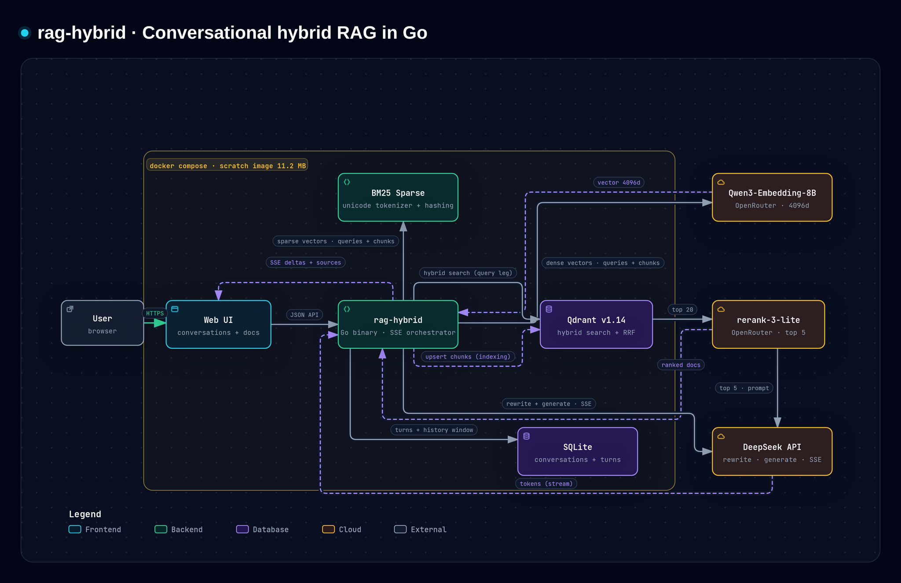
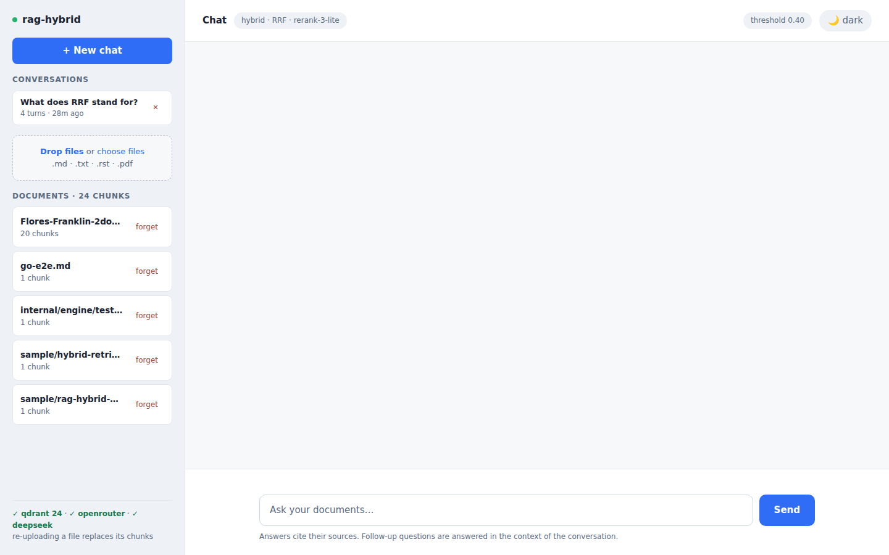

# rag-hybrid

[English](README.md) · **Español**

**RAG híbrido que cabe en una mano**: un único binario Go de 11 MB que conversa
con tus documentos usando embeddings densos de **Qwen3-Embedding-8B** + **BM25**
local, fusión **RRF** del lado del servidor, **rerank-3-lite** y respuestas
fundamentadas de **DeepSeek** — con una suite de evaluación juzgada por un LLM
que demuestra la calidad.





> Subí `.md` / `.txt` / `.rst` / `.pdf`, preguntá en lenguaje natural y recibí
> respuestas que citan sus fuentes. Cada etapa de la retrieval es medible.

## Por qué esto no es "una demo más de RAG"

| | RAG típico de portfolio | rag-hybrid |
|---|---|---|
| Retrieval | una API de embeddings | **híbrido**: denso + BM25 escrito a mano (Go), fusionados por RRF **dentro de Qdrant** |
| Calidad | "parece que anda" | **suite DeepEval, juez LLM, 4 métricas con umbrales** (abajo) |
| Despliegue | contenedor con runtime Python | **un binario Go estático, imagen scratch de 11 MB** |
| Español | se rompe con acentos | el tokenizador unicode mantiene `búsqueda` entera |

## Calidad medida (golden set juzgado por LLM)

Puntajes de `pytest -m eval evals/` contra la API viva (juez: DeepSeek):

| Métrica | Umbral | Puntaje (promedio de 6 preguntas) |
|---|---|---|
| Faithfulness — respuesta fundamentada en los docs recuperados | ≥ 0.85 | **1.00** |
| Contextual Precision — los chunks relevantes primero | ≥ 0.75 | **1.00** |
| Contextual Recall — se recuperaron todos los chunks necesarios | ≥ 0.70 | **1.00** |
| Answer Relevancy — responde la pregunta real | ≥ 0.70 | **0.92** |

*LLM-as-judge tiene varianza entre corridas: Answer Relevancy sacó 6/6 en una
corrida y 5/6 en otra (una pregunta 0.50). El harness de evaluación viaja en
el repo — corrilo vos mismo.*

## La historia del rewrite (por qué Go)

El primer motor era Python + Haystack + FastAPI (rama `feat/v1-scaffold`,
conservada por historia). Después de mover los modelos a APIs, el framework
era peso muerto, así que el motor se **reescribió en Go y se verificó que no
regresara** — mismo golden set, mismos umbrales:

| | Python (Haystack) | Go (solo stdlib) |
|---|---|---|
| Imagen Docker | 360 MB | **11.2 MB** (scratch) |
| RAM de la web app | ~200 MB | **~40 MB** |
| Baseline de eval | 6/6 | **6/6** |

## Perfil de costos

| Etapa | Precio |
|---|---|
| Qwen3-Embedding-8B (OpenRouter) | ~$0.06 / M tokens |
| rerank-3-lite (OpenRouter) | $0.02 / M tokens — **primeros 200M gratis** |
| deepseek-chat (API oficial) | precios de DeepSeek |
| BM25 + RRF + hosting | gratis (código local / tu Qdrant) |

Indexar un documento de 30 mil palabras cuesta ≈ **$0.003**; una pregunta
≈ **$0.0001**.

## Arranque rápido

```bash
cp env.example .env          # agregá OPENROUTER_API_KEY y DEEPSEEK_API_KEY
docker compose up -d --build # webapp (scratch) + Qdrant v1.14
open http://127.0.0.1:8000
```

O compilá el binario (Go 1.27, cero dependencias):

```bash
go build -o rag-hybrid ./cmd/rag-hybrid
docker compose up -d qdrant
./rag-hybrid index sample/ --recreate   # cualquier ruta: .md/.txt/.rst/.pdf
./rag-hybrid ask "How does RRF fuse the two ranked lists?"
./rag-hybrid serve
```

## Mapa del código

```
              ┌──────────────────┐    ┌───────────────────────────┐
              │ internal/server  │    │ cmd/rag-hybrid            │
              │ HTTP API + UI    │    │ serve · index · retrieve  │
              │ driving adapter  │    │ ask · forget              │
              └────────┬─────────┘    └─────────────┬─────────────┘
                       └────────────┐  ┌───────────┘
                                  │ calls
                                  ▼
┌──────────────────────────────────────────────────────────────────────────┐
│ internal/engine — THE CORE                                               │
│                                                                          │
│   document loading · chunking (400/50) · index & query flows             │
│   rewrite → hybrid retrieve → rerank → generate (SSE)                    │
│                         │ defines                                        │
│                         ▼                                                │
│   PORTS: VectorStore · Embedder · Reranker · LLM  (Go interfaces)        │
└────────────────▲──────────────────▲──────────────────▲───────────────────┘
                 │                   │                  │
                 │ implements        │ implements       │ implements
              ┌──┴────────────┐   ┌──┴─────────────┐  ┌──┴──────────────┐
              │ internal/     │   │ internal/      │  │ internal/       │
              │ qdrant        │   │ openrouter     │  │ deepseek        │
              │ hybrid + RRF  │   │ embeds · rerank│  │ chat · SSE      │
              └───────────────┘   └────────────────┘  └─────────────────┘

   internal/bm25 — unicode tokenizer            (used by the core directly)
   evals/ — DeepEval golden set                 (black-box HTTP, no imports)
```

Las dependencias apuntan hacia adentro (ports & adapters): el engine define
las interfaces que necesita, los adaptadores las implementan, y `cmd/` +
`server.New` son los composition roots que conectan los clientes concretos
con el engine.

## Evaluarlo vos mismo

```bash
uv sync                    # pytest + deepeval solamente (evals es el único Python que queda)
pytest -m eval evals/      # necesita la API corriendo + DEEPSEEK_API_KEY
```

## Despliegue

La imagen scratch se despliega donde corran contenedores; el binario también
corre desnudo (solo necesita HTTPS de salida):

```bash
# Ejemplo Fly.io (entra sobrado en free tiers: imagen 11 MB, ~40 MB RAM)
fly launch --dockerfile Dockerfile --name rag-hybrid
fly secrets set OPENROUTER_API_KEY=... DEEPSEEK_API_KEY=... QDRANT_URL=https://<tu-qdrant-cloud>
fly deploy
```

Qdrant Cloud tiene un tier gratis de 1 GB — o dejá Qdrant local y desplegá
solo el binario con un túnel público.

Ante SIGTERM o SIGINT (Ctrl+C, `docker stop`, deploys de plataformas) el
servidor deja de aceptar conexiones y drena los requests en vuelo —
generaciones SSE incluidas — por hasta 10 s antes de forzar el cierre de lo
que siga abierto y apagar SQLite limpiamente (exit 0). compose sube
`stop_grace_period` a 20 s para que el drain siempre le gane la carrera al
SIGKILL.

## Ciclo de vida de documentos

- **Uploads idempotentes**: indexar un archivo primero elimina sus chunks
  anteriores (delete-then-insert por source), así que re-subir nunca duplica.

- **Forget**: `rag-hybrid forget <file>` o `DELETE /api/documents?source=`
  elimina todos los chunks de un documento; la UI tiene un cuadro Forget.

- **"No está en el corpus" determinista**: cuando el mejor score de rerank
  queda por debajo de `RERANK_SCORE_THRESHOLD` (default 0.4) el sistema
  responde sin llamar al LLM — más barato, más rápido, sin camino a
  alucinaciones.

## Conversaciones

Los chats persisten en SQLite embebido (`DATA_DIR`, default `.data`, montado
como volumen en compose) y los follow-ups funcionan: la pregunta se reescribe
como query standalone contra los turnos recientes (la primera pregunta de un
chat se saltea el rewrite por completo), la retrieval cita fuentes de la
query REESCRITA, y las respuestas streamed token a token (SSE).
`HISTORY_TURNS` fija la ventana de contexto; `RETENTION_DAYS` (0 = nunca)
mueve una purga horaria — la eliminación como feature de compliance,
consistente con el `forget` de documentos.

## Notas

- Los PDFs se soportan vía un extractor de capa de texto (Go puro, sin cgo):
  los PDFs con texto indexan normal; los PDFs escaneados/solo-imagen se
  saltan con un motivo claro (OCR no está soportado).
- Qdrant fijado a `v1.14.1` (compose); la query híbrida usa patas prefetch
  REST + `{"fusion":"rrf"}`.
- El encoder sparse de BM25 se reescribió para Go (tokenizador unicode para
  español); la colección se reconstruyó desde cero — sin vectores legacy.
- La implementación Python se conserva en la historia de git en
  `feat/v1-scaffold`.

## Licencia

Apache-2.0 — ver [LICENSE](LICENSE).
