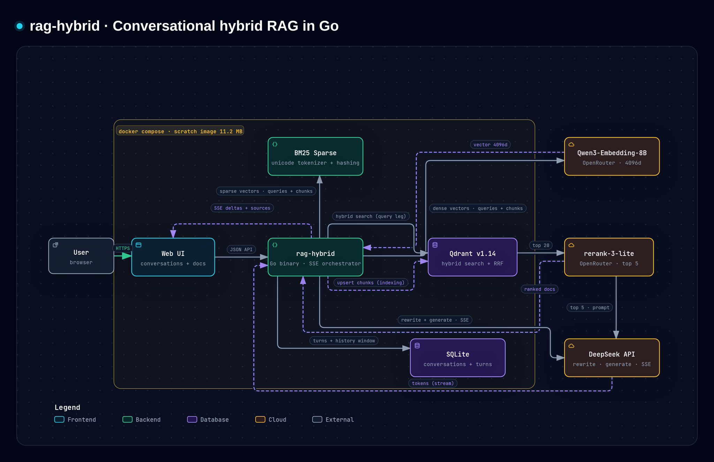
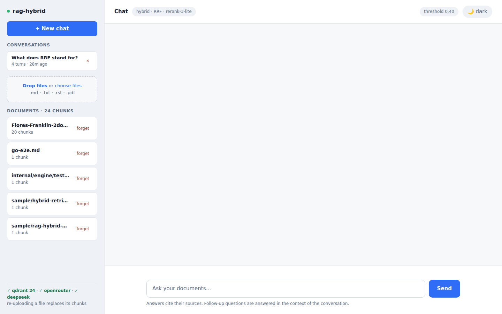

# rag-hybrid

**Hybrid RAG you can hold in one hand**: a single 11 MB Go binary that chats
with your documents using dense **Qwen3-Embedding-8B** + local **BM25**,
server-side **RRF** fusion, **rerank-3-lite** and grounded answers from
**DeepSeek** — with an LLM-judged evaluation suite proving the quality.





> Upload `.md` / `.txt` / `.rst` / `.pdf`, ask in natural language, get answers that
> cite their sources. Every retrieval stage is measurable.

## Why this is not "just another RAG demo"

| | Typical portfolio RAG | rag-hybrid |
|---|---|---|
| Retrieval | one embedding API | **hybrid**: dense + hand-written BM25 (Go), fused by RRF **inside Qdrant** |
| Quality | "looks right" | **DeepEval suite, LLM-judge, 4 metrics with thresholds** (below) |
| Deployment | container with Python runtime | **one static Go binary, 11 MB scratch image** |
| Spanish | breaks on accents | unicode tokenizer keeps `búsqueda` whole |

## Measured quality (LLM-judged golden set)

Scores from `pytest -m eval evals/` against the live API (judge: DeepSeek):

| Metric | Threshold | Score (avg of 6 questions) |
|---|---|---|
| Faithfulness — answer grounded in retrieved docs | ≥ 0.85 | **1.00** |
| Contextual Precision — relevant chunks ranked first | ≥ 0.75 | **1.00** |
| Contextual Recall — all needed chunks retrieved | ≥ 0.70 | **1.00** |
| Answer Relevancy — answers the actual question | ≥ 0.70 | **0.92** |

*LLM-as-judge has run-to-run variance: Answer Relevancy scored 6/6 in one
run and 5/6 in another (one question 0.50). The eval harness ships in the
repo — run it yourself.*

## The rewrite story (why Go)

The first engine was Python + Haystack + FastAPI (branch `feat/v1-scaffold`,
kept for history). After moving the models to APIs, the framework was dead
weight, so the engine was **rewritten in Go and verified to not regress** —
same golden set, same thresholds:

| | Python (Haystack) | Go (stdlib only) |
|---|---|---|
| Docker image | 360 MB | **11.2 MB** (scratch) |
| Web app RAM | ~200 MB | **~40 MB** |
| Eval baseline | 6/6 | **6/6** |

## Cost profile

| Stage | Price |
|---|---|
| Qwen3-Embedding-8B (OpenRouter) | ~$0.06 / M tokens |
| rerank-3-lite (OpenRouter) | $0.02 / M tokens — **first 200M free** |
| deepseek-chat (official API) | DeepSeek pricing |
| BM25 + RRF + hosting | free (local code / your Qdrant) |

Indexing a 30k-word document costs ≈ **$0.003**; a question ≈ **$0.0001**.

## Quickstart

```bash
cp env.example .env          # add OPENROUTER_API_KEY and DEEPSEEK_API_KEY
docker compose up -d --build # webapp (scratch) + Qdrant v1.14
open http://127.0.0.1:8000
```

Or build the binary (Go 1.27, zero dependencies):

```bash
go build -o rag-hybrid ./cmd/rag-hybrid
docker compose up -d qdrant
./rag-hybrid index sample/ --recreate   # any path: .md/.txt/.rst/.pdf
./rag-hybrid ask "How does RRF fuse the two ranked lists?"
./rag-hybrid serve
```

## Code map

```
cmd/rag-hybrid/       CLI: serve / index / retrieve / ask
internal/bm25/        unicode tokenizer + hashed sparse encoder (~110 lines)
internal/openrouter/  embeddings + rerank HTTP clients
internal/qdrant/      REST client: ensure / upsert / hybrid query (RRF) / drop
internal/engine/      loading, chunking (400/50), index & query flows
internal/server/      net/http API + web UI embedded via go:embed
evals/                DeepEval harness + golden set (implementation-agnostic HTTP)
```

## Evaluating it yourself

```bash
uv sync                    # pytest + deepeval only (evals are the sole Python left)
pytest -m eval evals/      # needs the API running + DEEPSEEK_API_KEY
```

## Deploying

The scratch image deploys anywhere containers run; the binary also runs
bare (it only needs outbound HTTPS):

```bash
# Fly.io example (fits free tiers easily: 11 MB image, ~40 MB RAM)
fly launch --dockerfile Dockerfile --name rag-hybrid
fly secrets set OPENROUTER_API_KEY=... DEEPSEEK_API_KEY=... QDRANT_URL=https://<your-qdrant-cloud>
fly deploy
```

Qdrant Cloud has a free 1 GB tier — or keep Qdrant local and deploy only
the binary with a public tunnel.

## Notes

- PDFs are supported via a text-layer extractor (pure Go, no cgo): text
  PDFs index normally; scanned/image-only PDFs are skipped with a clear
  reason (OCR is not supported).
- PDFs are supported via a text-layer extractor (pure Go, no cgo): text PDFs index normally; scanned/image-only PDFs are skipped with a clear reason (OCR is not supported).

- Qdrant pinned to `v1.14.1` (compose); the hybrid query uses REST prefetch
  legs + `{"fusion":"rrf"}`.
- The BM25 sparse encoder was rewritten for Go (unicode tokenizer for
  Spanish); the collection was rebuilt from scratch — no legacy vectors.
- Python implementation preserved in git history on `feat/v1-scaffold`.
